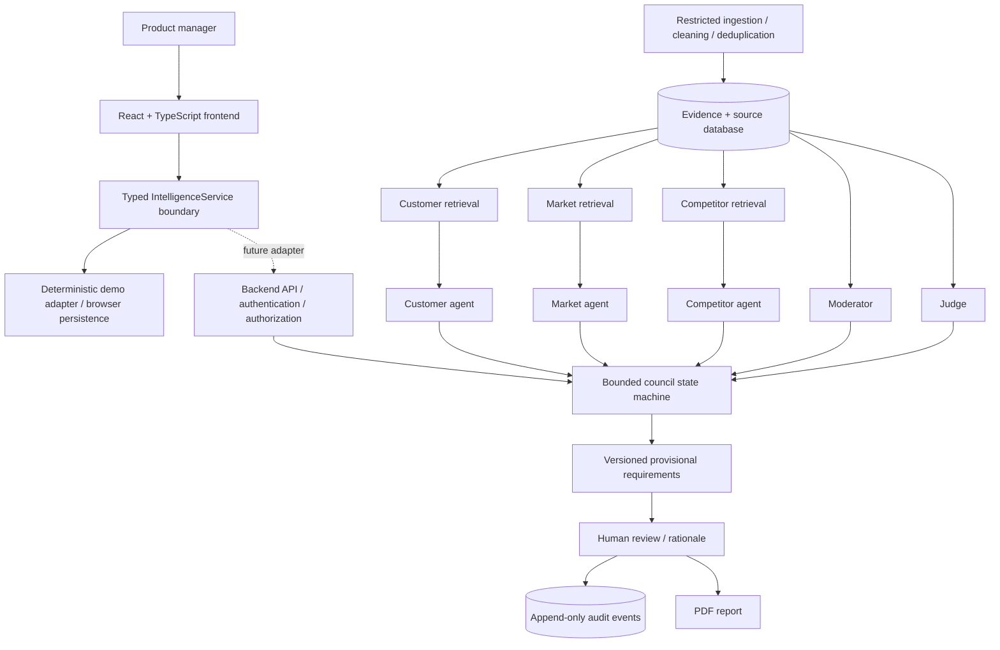
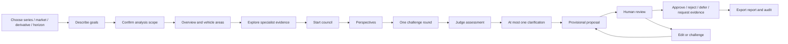

# BMW NEXT — Product Specification and Technical Design

**Status:** Hackathon prototype specification · 10 October 2026
**Context:** TUM AI Hackathon — BMW Challenge, Munich (team-provided brief)
**Product principle:** AI analyzes. AI challenges. AI explains. Humans decide.

This document is the complete team product brief, followed by implementation contracts and integration guidance. Challenge descriptions and dataset names below are supplied by the team; the moderator now inventories the supplied workbook/PDF contents privately, while the other dashboard analysis remains synthetic. No real BMW datasets or licensed BMW vehicle assets were present in the repository at project initialization. All initial application evidence is synthetic and must be marked DEMO. This is an unofficial hackathon concept.

## Document scope

The product requirements below are authoritative. The frontend visual specification is retained in full. Implementation choices and open questions follow them; recommendations do not imply that a production backend, real inference, or retrieval security exists in the prototype.

## Moderator implementation contract — October 2026

This contract supersedes the scripted council behavior described later in this document. The moderator runs in a separate Python/FastAPI service. Specialist and judge reasoning remain adapter-owned. The supplied eight Drive datasets and Discord-supplied BMW Group Report 2025 form the initial source inventory. External sources are also allowed, following the organizer clarification relayed on 10 October 2026. Public HTTPS HTML, text and PDF imports retain publisher, declared source quality, retrieval/publication dates, content hashes, scope and locators. No agent may silently inject uncaptured web content into a confirmed discussion: new imports are available to new agendas, while existing agendas keep their frozen snapshots. Primary OEM documentation, official statistics and original research are preferred; external pages do not automatically establish a verified competitive gap. Raw inputs, extracted passages, source hashes, and the SQLite checkpoint/event database stay in ignored private storage.

The PM confirms a versioned, evidence-derived agenda once. Up to six topics are proposed with the entire explained backlog. Agenda weights are customer need 40%, severity 35%, future relevance 20%, verified competitive gap 5%. Unknown factors remain unknown; show supported score contribution, upper bound and known-weight coverage without renormalization. Pins and substantiated severe issues precede score order. Every rating carries references and rationale. Topics are customer-facing questions, not preapproved solutions.

Workflow: agenda confirmation → neutral topic brief → three concurrent independent positions → claim checks → one challenge round (all challenges before consolidated replies) → judge assessment → optional single, answerable clarification → closure and judge packet → next topic. Each specialist may abstain. Consensus never constitutes a closure gate. Close with completed, insufficient evidence, unresolved disagreement, budget exhausted, or PM stopped. Queue human review and continue without approving requirements. Pauses and interruptions preserve checkpoints; finish/skip produce explicit incomplete outcomes. Resume never renews exhausted budgets. Default limits are 45 seconds/call, 300 active seconds/topic and 60,000 total model tokens/topic, with 20% reserved for assessment and closure; one output-repair attempt fits within the same limits.

Contracts: Agenda, TopicBrief, AgentPosition, Claim, Challenge, Assumption, JudgePacket and TopicOutcome. Evidence domains are separate from agent identities. Ordered events include session/run/topic IDs, sequence, timestamp, source IDs and assumption versions. Source scope, exclusions, units, dates, denominators and calculations are checked in code. Semantic source support is a separate model check; an absent verifier is disclosed, never represented as validation. Published discussion and source excerpts are untrusted content, not instructions.

Feedback is deduplicated by source file + feedback ID while retaining all classifications/row locators and positive, mixed and unclassified observations. Expected rows/IDs: F70 4076/2128, G60 5005/4000, G70 4690/4000. IDs are not unique customers. Preserve country, powertrain, source and missing dates. China has no supplied feedback. EU studies, geographic Europe feedback, G68 vs G60 and G60_G68 sales must remain distinct. US study sample totals of 1 are normalized proportions, not respondent counts. Unknown rating scales and sample sizes stay unknown. Sales 2030 is a supplied future figure; zero volumes do not establish unavailability. Equipment is tied to document edition, market, derivative, standard/optional status and package dependencies; uncertain table extraction is not verified availability.

Annual report focus: pages 42–46, 53–57, 77–81 and 262–265, preserving group/brand/model-family aggregation and the difference between results, 2026 outlook, targets and announcements. Corporate strategy/R&D supports alignment, not proof of model-specific feasibility or customer demand. No verified competitor feature matrix was supplied initially; external peer documentation may fill the gap only with equivalent market, derivative, date and equipment-status comparisons. Until then, competitor abstention and comparability challenges are valid outcomes.

Assumptions have IDs, versions, scope, authors, rationale, evidence, dependencies and validation needs. Proposed, contested, accepted-for-scenario, refuted and superseded are distinct states. Acceptance does not make an assumption factual. Preferences, missing data, limitations and source forecasts are not interchangeable with assumptions. Changes invalidate dependent assessments and preserve their history. The judge receives original claims, positions, challenges, rebuttals, counterevidence, alternatives, assumption versions, unresolved issues, coverage limitations and the complete published transcript with source locators.

Acceptance requires source-count/lineage checks, deterministic scoring and numerical checks, scope-transfer failures, independent openings, dissent retention, conditional clarification, every closure path, pause/restart/reconnect/idempotency and targeted assumption invalidation. Moderator-quality cases compare independent positions with moderated output; model quality remains unevaluated until PM review, even when deterministic tests pass. Production authentication/deployment and new specialist/judge algorithms are outside this change.

# BMW NEXT — AI Product Intelligence & Decision Platform

## 1. Project Overview

**Project name:** BMW NEXT (working title)

**Event:** TUM AI Hackathon — BMW Challenge

**Project type:** Multi-agent AI product intelligence and decision-support platform.

### 1.1 The problem

Automotive product managers must transform enormous quantities of fragmented information into customer requirements for future generations of vehicles.

The information comes from multiple heterogeneous sources:

- Customer feedback and complaints
- Customer satisfaction studies
- BMW product and equipment data
- Regional sales information
- Competitor products and features
- Market trends and forecasts
- External research

Currently, this requires substantial manual analysis, and product decisions can be difficult to explain, compare, validate, and trace back to their original evidence.

Our platform aims to improve this process using specialized AI agents, structured debate, transparent prioritization, and human decision-making.

### 1.2 The vision

Create a futuristic BMW product intelligence platform where a product manager can:

- Choose a BMW vehicle and target market.
- Explore a realistic, interactive 3D vehicle.
- Understand customer needs, market trends, and competitor advantages.
- Watch specialist AI agents debate proposed requirements.
- Inspect the evidence behind every argument.
- Intervene, challenge, correct, or approve important decisions.
- Explore alternative requirements and future scenarios.
- Understand estimated customer impact, risks, uncertainties, and rough feasibility.
- Track every important change in an audit trail.
- Export a polished product requirements report.

The objective is NOT to replace the product manager.

The objective is to give them an exceptionally powerful AI-powered decision-support environment.

### 1.3 Core product philosophy

**AI analyzes. AI challenges. AI explains. Humans decide.**

The system must be transparent, evidence-based, modular, auditable, and visually intuitive.

---

## 2. BMW Challenge Requirements and Scope

The challenge is to derive, justify, and prioritize customer-facing requirements for the successor of an existing BMW vehicle.

The primary supported vehicle families are:

- BMW 1 Series — F70
- BMW 5 Series — G60
- BMW 7 Series — G70

The supplied customer study additionally contains G68 data.

Target markets include:

- Europe
- United States
- China

The architecture must support additional vehicles and markets in the future.

The default planning horizon is approximately 3–5 years.

### 2.1 In scope

- Customer-facing product requirements
- Vehicle equipment and options
- Interior/exterior usability
- Space and comfort
- Infotainment and digital experiences
- Driving experience
- Customer-perceived charging convenience and range
- Design and quality perception
- Equipment packages and variants
- Customer expectations and future trends

### 2.2 Out of scope

- Detailed engineering specifications
- Regulatory and homologation requirements
- Supplier decisions
- Engineering architecture
- Detailed financial business cases
- Precise pricing and cost calculations

Rough implementation effort, feasibility, and cost-related uncertainty may be considered when ranking requirements.

Do not fabricate detailed cost estimates or financial returns.

### 2.3 Required outcomes

The application must demonstrate:

1. Processing heterogeneous information.
2. Converting evidence into structured findings.
3. Deriving actionable customer-facing requirements.
4. Prioritizing those requirements.
5. Making supporting evidence and assumptions visible.
6. Human review and approval.
7. Chronological traceability and auditability.

---

## 3. Provided Data Sources

The challenge organizers have supplied these datasets:

### Customer feedback

- `F70_feedback_hackathon.xlsx`
- `G60_feedback_hackathon.xlsx`
- `G70_feedback_hackathon.xlsx`

These contain customer statements and associated metadata.

Potential fields include feedback IDs, country, model, powertrain, feedback type, classification, and free-text comments.

One customer comment may appear across multiple classification rows. Duplicate comments must not automatically be treated as independent customer observations.

### Equipment information

- `F70_OptionList.PDF`
- `G60_OptionList.PDF`
- `G70_OptionList.PDF`

These describe BMW vehicle configurations, features, and equipment.

### Customer studies

- `F70_G60_G68_G70_customer_studies.xlsx`

Includes vehicle satisfaction and category-specific customer ratings.

### Sales information

- `sales_volumes.xlsx`

Includes region-specific vehicle volumes for 2024, 2025, and 2030.

The 2030 values should be treated as provided future figures, not observed historical sales.

### External data

The system should support future ingestion of public sources about:

- Competitor equipment
- Competitive positioning
- Consumer research
- Market developments
- Automotive technology trends
- Customer preferences

External claims must carry verifiable source references and publication dates.

**Important:** Do not assume direct access to Google Drive. Supplied files are ingested privately when accessible. External evidence is also permitted through the captured source-intake workflow in the authoritative moderator contract. Synthetic fixtures must be clearly labelled and never substituted silently for missing evidence.

Do not commit confidential BMW customer data or personal information to a public repository.

---

# 4. Multi-Agent AI Architecture

The platform's central intelligence system is a structured AI council.

There are three main specialist agents, one moderator, and one judge.

The agents are intentionally specialized and receive different information.

## 4.1 Customer Agent

**Responsibility:** Represent the customer perspective.

Accessible information:

- Customer feedback
- Customer satisfaction studies
- Customer complaints and requests
- Related customer-evidence metadata

It should identify:

- Recurring complaints
- Most requested features
- Unmet customer needs
- Positive features that must be retained
- Customer-experience friction
- Segment-specific differences
- Relevant customer priorities

It must support claims with original feedback or study references.

It must distinguish unique customers, feedback records, and extracted findings.

## 4.2 Market Trends Agent

**Responsibility:** Represent the market and future outlook.

Accessible information:

- Market and regional sales data
- Relevant external trend research
- Future-facing market and technology information

It should identify:

- Regional demand signals
- Market developments
- Historical performance patterns
- Future customer expectations
- Growth opportunities
- Potential shifts in preferences
- Market-related risks and uncertainties

It must distinguish observed data, supplied forecasts, and assumptions.

## 4.3 Competitor Agent

**Responsibility:** Represent the competitive perspective.

Accessible information:

- Competitor vehicle research
- Public competitor equipment and features
- Public competitive analyses
- Relevant competitor experience comparisons

It should identify:

- Competitive advantages
- Missing or weaker offerings
- Emerging competitive features
- Relevant product differentiation
- Potential threats and opportunities

It must compare relevant models, markets, configurations, and feature availability fairly.

## 4.4 Moderator Agent

**Responsibility:** Control the discussion workflow.

The moderator is not simply another argumentative agent.

It should:

- Introduce topics in a predetermined sequence.
- Present the scope and objective.
- Request independent positions from the three agents.
- Manage challenges and rebuttals.
- Prevent off-topic conversation.
- Enforce time/round limits.
- Summarize meaningful agreements and disagreements.
- Escalate uncertainties to the judge or human PM.
- Keep the discussion structured and coherent.

The moderator has access to the complete information needed to coordinate the workflow.

The sequence must be implemented as an explicit workflow/state machine, not trusted entirely to an LLM prompt.

## 4.5 Judge Agent

**Responsibility:** Evaluate proposals and their supporting reasoning.

The judge has broader access to the evidence database.

Its responsibilities:

- Examine agent claims and source evidence.
- Detect contradictory statements.
- Flag missing or weak evidence.
- Identify unsupported assumptions.
- Evaluate rough feasibility and effort.
- Consider qualitative cost-related risks where evidence exists.
- Evaluate customer relevance.
- Apply a predefined scoring rubric.
- Identify risks and uncertainties.
- Prepare provisional assessments.
- Recommend possible next steps.

The judge must not be presented as perfectly unbiased.

Its outputs must be inspectable, challengeable, and subject to human review.

It cannot autonomously make final product-management approval decisions.

## 4.6 Retrieval and access architecture

The system will eventually use multiple domain-specific RAG pipelines.

Conceptual structure:

Customer RAG → Customer Agent

Market RAG → Market Trends Agent

Competitor RAG → Competitor Agent

All evidence domains → Moderator / Judge, subject to backend access policies

The specialist agents should have genuinely restricted retrieval access, not just a prompt telling them to ignore other data.

The moderator and judge need broader retrieval access to evaluate cross-domain arguments.

For now, create clean frontend/backend contracts that allow this system to be integrated later.

---

# 5. Structured AI Council Debate

Debates occur per topic or potential requirement.

Examples include:

- Charging convenience
- Battery/range experience
- Rear-seat comfort
- Trunk usability
- Infotainment usability
- Interior storage
- Digital services
- Driver-assistance usability

The selected topic must be relevant to the chosen vehicle, market, and powertrain.

## 5.1 Fixed debate workflow

**Stage 1 — Topic selection**

The moderator introduces one topic, defines the vehicle/market context, and states the customer-facing question.

**Stage 2 — Independent agent analysis**

Each specialist provides:

- Its position
- Relevant evidence
- An initial recommendation
- Uncertainties
- Supporting source references

**Stage 3 — Structured debate**

The agents challenge important claims and conflicting interpretations.

The goal is not arbitrary conversation. The goal is better-supported requirements.

One challenge round by default.

**Stage 4 — Judge assessment**

The judge examines the evidence, identifies assumptions, detects inconsistencies, and gives an initial assessment.

**Stage 5 — Optional clarification**

The moderator may request one targeted additional response when necessary.

Do not allow unrestricted debate loops.

**Stage 6 — Requirement generation**

The system generates one or more provisional requirements, alternatives, scores, risk estimates, evidence summaries, and assumptions.

Consensus is not mandatory.

Unresolved disagreements should remain visible.

**Stage 7 — Human review**

The PM can:

- Approve
- Reject
- Edit
- Challenge
- Defer
- Request more evidence

The decision and its rationale must be recorded.

## 5.2 Debate constraints

- Deterministic stage ordering.
- Maximum number of rounds.
- Maximum debate duration or token budget.
- No unsupported assertions treated as facts.
- Source links for consequential claims.
- Numeric calculations handled by deterministic functions where possible.
- Human interruption available at any stage.
- Pause/resume functionality.
- Preserve unresolved disagreements.
- Full auditability of decisions.

## 5.3 Debate presentation

The frontend should NOT overwhelm product managers with hundreds of chat messages.

Default to a concise, structured summary.

Offer an expandable panel containing:

- Agent statements
- Challenges
- Evidence references
- Moderator summaries
- Judge assessments
- Assumptions
- Revision history

This panel represents the generated discussion, not hidden private model reasoning.

---

# 6. Human-in-the-Loop Decision System

Humans must remain in control of consequential decisions.

The PM can:

- Define initial goals and constraints.
- Adjust priorities.
- Approve or reject requirements.
- Edit requirement descriptions.
- Challenge evidence.
- Exclude inappropriate evidence with an explanation.
- Ask for alternative scenarios.
- Interrupt agent processing.
- Reopen previously reviewed requirements.

Mandatory human checkpoints include:

1. Scope and key preference confirmation.
2. Resolution of consequential uncertainties when required.
3. Final approval of product requirements.

Avoid requesting human approval for every minor automated task.

Approval applies to a specific requirement version.

Significant edits must create a new reviewable version.

---

# 7. Quantitative Evidence and Prioritization

Every important claim must be backed by the strongest available evidence.

However, the system must not fabricate numerical certainty.

For example, a feature mentioned in 25% of filtered feedback records does not necessarily mean 25% of all customers demand it.

Every quantitative claim should expose:

- Data source
- Sample size
- Denominator
- Filters
- Relevant market
- Time frame
- Calculation method
- Relevant limitations

The prioritization framework should consider:

- Observed customer need
- Severity of the issue
- Competitive gap
- Future relevance
- Evidence quality
- Rough feasibility/effort

Use configurable, transparent scoring rules.

Keep evidence strength distinct from business priority.

Missing information should remain unknown rather than silently becoming zero.

The PM should be able to adjust priorities and inspect the resulting changes.

---

# 8. Requirements and Decisions

Each proposed requirement must have a structured record.

Required fields:

- Unique requirement ID
- Vehicle and market
- Topic or vehicle subsystem
- Customer-facing requirement description
- Source-linked supporting findings
- Evidence references
- Priority score
- Prioritization rationale
- Evidence level
- Future assumptions
- Uncertainties
- Potential customer impact
- Risk
- Rough feasibility/effort
- Alternative decisions
- PM decision status
- Requirement version
- Change history

The platform should show alternative decisions where meaningful.

For example, rather than recommending one improvement without explanation, it could compare multiple possible responses to the same underlying customer need.

---

# 9. Future Scenarios and Risk–Impact Analysis

The application should help PMs explore different possible futures.

Examples:

- Customer-experience-focused scenario
- Balanced product strategy
- Future-innovation scenario
- Low-effort improvement scenario

Each scenario should state its assumptions.

For each decision alternative, display:

- Potential customer value
- Uncertainty
- Risk
- Evidence strength
- Rough effort
- Sensitivity to future assumptions

Include a risk-versus-potential-impact visualization.

Allow the PM to adjust assumptions and compare different prioritization outcomes.

The platform should not claim accurate future sales uplift or ROI without suitable evidence.

Scenario simulations represent assumptions and model sensitivity, not guaranteed market forecasts.

---

# 10. Product Interface and Navigation

The platform should feel like a premium BMW digital environment, not enterprise dashboard software.

## 10.1 Initial homepage

A minimalistic, futuristic BMW-branded landing experience.

The main feature is an accurate, interactive 3D BMW vehicle.

Initially, users only see:

- BMW branding
- A large hero vehicle
- Minimal navigation
- Vehicle selection
- Market selection
- Planning horizon
- A natural-language input
- Start Analysis

Keep the initial view uncluttered.

## 10.2 Progressive navigation

After analysis begins, unlock:

- Overview
- Customer Intelligence
- Market Trends
- Competitor Intelligence
- Agent Council
- Decisions & Scenarios
- Audit Trail

## 10.3 Interactive vehicle

A rotatable, zoomable, high-quality 3D BMW vehicle.

Support exploration of relevant customer-requirement areas.

Selecting a vehicle area should display:

- Associated requirements
- Relevant customer evidence
- Competitive findings
- Risk/impact
- Review status

## 10.4 Agent intelligence dashboards

Each specialist agent has its own dedicated page.

**Customer Intelligence:** Ranked customer complaints, requested features, satisfaction patterns, sentiment/themes, data filters, evidence drilldowns.

**Market Trends:** Regional sales charts, future assumptions, trend visualizations, market signals, projections.

**Competitor Intelligence:** Competitor comparisons, feature gaps, relevant product advantages, evidence and source references.

## 10.5 Agent Council

A debate environment with animated 3D agent representations, evidence-derived agendas, deterministic workflow gates, summaries and an expandable published transcript.

## 10.6 Decisions & Scenarios

Interactive requirement cards, priority rankings, risk-versus-impact charts, alternative decisions, PM review controls, and scenario exploration.

## 10.7 Audit Trail

Chronological history of requirements, evidence changes, score adjustments, agent actions, and human decisions.

## 10.8 PDF Export

A professional, downloadable report summarizing:

- Selected vehicle and market
- Requirements
- Evidence
- Agent assessments
- Risks and assumptions
- Scenario analysis
- Human decisions
- Audit history

---

# 11. Auditability and Transparency

Every important action should be recorded.

Event fields should include:

- Event ID
- Timestamp
- Actor
- Action type
- Related requirement ID
- Previous state
- New state
- Evidence references
- Rationale
- Requirement version

The audit trail must allow a reviewer to trace:

Source → Finding → Requirement → Prioritization → Human Decision.

Use an append-only event model for consequential changes.

Do not treat the debate transcript as a substitute for the audit trail.

---

# 12. Technical Architecture

Recommended frontend:

- Next.js
- React
- TypeScript
- Tailwind CSS
- shadcn/ui
- React Three Fiber
- Three.js
- Drei
- Motion/Framer Motion
- Recharts
- Zustand
- React PDF or another suitable PDF library

Future backend:

- FastAPI or equivalent
- Python agent orchestration
- Domain-specific RAG
- Relational database
- Vector search
- Typed data schemas
- Structured workflow/state machine
- Audit event storage

Keep backend technology interchangeable where possible.

Create clean interfaces and mock API adapters first.

The frontend should be integration-ready, but the initial implementation need not contain actual AI inference or live research.

---

# 13. Development Responsibilities and Modules

The project must be modular so teammates can work in parallel.

Recommended ownership areas:

**Frontend / 3D UX**

- Application shell
- Hero vehicle
- Agent avatars
- Council interface
- Charts and dashboards

**Data Engineering / Retrieval**

- Data ingestion
- Cleaning and deduplication
- Source tracking
- Domain-specific retrieval
- Indexing

**AI Agents / Orchestration**

- Three specialist agents
- Moderator
- Judge
- Deterministic workflow
- Evidence validation

**Product Logic / Backend**

- Requirement records
- Scoring
- Scenarios
- Human approval
- Audit logging
- Export

Define interfaces between these modules.

---

# 14. MVP and Stretch Features

## Essential MVP

- Beautiful initial 3D homepage
- Vehicle and market selection
- Usable workspace navigation
- Three agent dashboards
- Structured simulated debate
- Judge assessment
- Requirement proposal and prioritization
- Human review actions
- Audit logging
- PDF export

## Advanced Features

- Fully animated 3D agent council
- Premium WebGL/shader effects
- Interactive requirement hotspots
- Live agent message streaming
- Interactive scenario sensitivity analysis
- Sophisticated visualization of uncertainties
- Real external research integration
- Rich source drilldowns

## Future Extensions

- Additional BMW vehicles and markets
- More advanced forecasting
- Real customer validation workflows
- Additional specialized agents
- Integration with internal BMW systems

All advanced features must preserve transparency and human control.

---

# 15. Success Criteria

The project is successful when a PM can:

1. Select a BMW vehicle and market.
2. Understand the available data.
3. Inspect customer, trend, and competitor insights.
4. Start a structured AI council discussion.
5. Understand each agent's evidence.
6. Review the judge's assessment.
7. See clear proposed requirements.
8. Compare risk, impact, and alternative assumptions.
9. Make an explicit decision.
10. Trace that decision back to its original sources.
11. Export a professional report.

---

# 16. Open Questions and Assumptions

Document any unresolved choices here, including:

- Actual availability and licensing of BMW 3D assets.
- Final team architecture and backend technologies.
- Scoring weights.
- Which market and vehicle will be the final demonstration focus.
- Availability and quality of external competitor data.
- Availability of trustworthy feasibility estimates.
- API contracts and agent streaming protocols.

Distinguish confirmed challenge requirements from proposed implementation decisions.

---

# PART 2 — FRONTEND IMPLEMENTATION

After creating `PROJECT_SPEC.md`, begin implementing the frontend.

**Do not stop after writing documentation.**

Read the specification you created and use it as the source of truth.

## 1. Creative direction

The frontend should combine:

**BMW premium automotive design + futuristic AI intelligence laboratory + sophisticated editorial minimalism.**

We want something visually unforgettable, but not messy.

Design adjectives:

- Futuristic
- Chic
- Minimalistic
- Luxurious
- Immersive
- Technical
- Precise
- Cinematic
- Sophisticated
- Beautifully animated

Think of the polish of a premium automotive configurator combined with an advanced AI research interface.

Use BMW-inspired white, black, blue, silver, and graphite.

Suggested colors:

- White: #FFFFFF
- BMW blue: #0066B1
- Deep blue: #003A70
- Midnight blue: #071A2E
- Graphite: #15171B
- Silver: #C5CCD3
- Light grey: #F4F6F8

The homepage should mainly be white/light.

The Agent Council can introduce an immersive dark-blue/graphite environment for visual contrast.

Do not turn the entire product into a neon cyberpunk interface.

Use clear typography, elegant spacing, refined microinteractions, and highly disciplined visual hierarchy.

Use the BMW logo only from a legitimate supplied or appropriately licensed asset. This is a hackathon prototype, not an official BMW production application.

## 2. Use 21st.dev for advanced UI inspiration

I specifically want you to explore:

https://21st.dev

Use suitable components or inspiration from its catalog for:

- Animated hero sections
- Shader backgrounds
- WebGL visualizations
- Liquid metal effects
- Premium interactive navigation
- Animated AI interfaces
- Magnetic buttons
- Elegant card hover effects
- Scroll transitions
- Futuristic glowing borders
- Smooth text animations
- Beautiful loading states

If 21st MCP is already available, use it to discover relevant components.

If setup is available and authorized, consult:

https://21st.dev/mcp

For Codex, the documented CLI setup may be used when appropriate:

`npx @21st-dev/cli@latest init --client codex`

Do not expose API keys or require paid services merely to complete the prototype.

Inspect component licensing, dependencies, and performance before adopting code. Adapt components to a consistent BMW aesthetic rather than mixing unrelated designs.

Do not install dozens of animation packages.

Use sophisticated visual effects selectively.

## 3. Main homepage: premium 3D BMW experience

Create a full-screen hero centered around a visually stunning 3D BMW.

The car must be:

- Fully rotatable through 360°
- Zoomable
- Interactive with mouse and touch
- Rendered with physically based materials
- Illuminated by realistic sunlight and environment lighting
- Grounded by high-quality soft shadows
- Smoothly animated
- Properly framed by the camera

Use React Three Fiber and Drei.

Prefer an actual, appropriately licensed BMW 5 Series G60 model.

If none exists, build a high-quality viewer that supports model loading and uses a clearly labelled fallback. Do not fabricate a generic car and claim it is an accurate BMW.

Photorealistic visual lighting matters; a real vehicle physics engine is not necessary for a stationary product viewer.

Add subtle environmental visual elements:

- Light-reflective studio floor
- Soft volumetric atmosphere where performant
- Gentle camera movement
- Smooth reflections
- Tasteful shader transitions
- Elegant model-loading animation

The car is the hero. Effects must never obscure it.

### Homepage layout

Top navigation:

BMW logo — BMW NEXT — minimal profile control

Main content:

"The Next Generation, Informed by Intelligence."

Supporting text:

"From customer voices to confident product decisions."

A huge, beautiful vehicle visualization.

Subtle configuration controls:

- Series
- Market
- Powertrain/derivative where available
- Planning horizon

A natural-language prompt field:

"What should BMW's next generation prioritize?"

Example prompts:

"Explore customer priorities for the next BMW 5 Series in Europe."

"Prioritize electric driving experience and charging convenience."

"Find high-impact improvements with lower implementation effort."

Primary CTA:

**Start Product Analysis →**

When clicked, smoothly transition into the workspace.

Preserve the selection across pages.

Do not overcrowd the initial homepage with dashboards.

## 4. Interactive 3D AI Agent Characters

THIS IS A KEY VISUAL FEATURE.

Create distinct **animated 3D representations for the AI agents**.

They should look premium, futuristic, and intelligent.

Avoid cute cartoons, childish robots, stock illustrations, generic emoji, or overdesigned humanoid mascots.

Prefer elegant, abstract, sculptural, semi-holographic 3D entities.

Each character should have a distinct design language and personality.

### Customer Agent — Empathy / Human Voices

Visual inspiration:

A flowing blue holographic figure or sculpture with soft light waves, organic movement, and subtle voice-like pulses.

Appearance:

- BMW blue
- Soft luminous elements
- Organic shapes
- Refined glass-like materials

Animation:

- Gentle breathing/pulsing
- Wave-like motion when speaking
- Subtle energy increase when presenting evidence

### Market Trends Agent — Motion / Foresight

Visual inspiration:

A futuristic abstract entity composed of orbiting arcs, fluid ribbons, or shifting geometric structures.

Appearance:

- Midnight blue
- Cyan-blue highlights
- Metallic or glass surfaces
- Dynamic orbital elements

Animation:

- Rotating rings
- Shifting data-like patterns
- Faster controlled movement while speaking

### Competitor Agent — Precision / Analysis

Visual inspiration:

A sleek reflective geometric sculpture, crystalline prism, or angular chrome-like AI entity.

Appearance:

- Silver
- Graphite
- Steel-blue accents
- Sharp, precise geometry

Animation:

- Rotating geometric components
- Controlled reflective pulses
- Precise movements during challenges

### Moderator — Coordination

A smaller, elegant, neutral holographic or geometric figure positioned centrally.

Appearance:

- White/silver
- Restrained BMW blue accents
- Clean circular/ring structure

Animation:

- Activates when introducing stages
- Directs attention between agents
- Uses subtle visual transitions between debate rounds

### Judge — Evaluation / Authority

A visually distinguished, elegant abstract entity.

Appearance:

- Dark metallic graphite
- Blue-white luminous core
- Symmetrical, balanced geometry

Animation:

- Quiet and stable while evaluating
- Controlled transformation when presenting assessments
- Subtle illumination changes when flagging assumptions or conflicts

### Character behavior

Create reusable visual states:

- Idle
- Thinking
- Speaking
- Challenging
- Waiting
- Evaluating
- Paused
- Complete

Transitions should be smooth.

When an agent speaks, its avatar animates while the others remain quietly active.

When the moderator changes the topic, the visual focus shifts accordingly.

When the judge speaks, the scene subtly emphasizes the judge.

No actual speech audio or lip synchronization is required for MVP.

These should be functional UI representations driven by agent state, not merely decorative characters.

Use procedural Three.js geometry and shader materials where possible so the prototype does not depend on expensive external character assets.

Respect reduced-motion settings and provide static fallbacks.

## 5. AI Council Chamber

Create a dedicated **Agent Council** page.

This should be one of the most visually impressive parts of the application.

The concept is a futuristic BMW intelligence council chamber.

Imagine an elegant virtual analysis room:

- Dark blue/graphite environment
- Three main agent sculptures arranged around a subtle central discussion area
- Moderator in a visually central position
- Judge positioned separately as evaluator
- Floating evidence panels
- Delicate ambient lighting
- Subtle depth and reflections
- High-end motion design

The agent characters should be visually engaging without obstructing information.

### Main layout

The viewport should balance:

**Left:** Current debate topic, context, stages, and controls.

**Center:** 3D AI council visualization.

**Right:** Current evidence, summary, assumptions, and judge assessment.

Use responsive layouts.

### Debate flow

Create a clear horizontal or vertical progress indicator:

Topic → Perspectives → Challenge → Assessment → Revision → Proposal → PM Review

Animate the relevant stage.

When an agent is speaking:

- Highlight its avatar.
- Show a concise text statement.
- Display its evidence.
- Animate its energy/shader state.

Allow the user to open **Expand Debate** for the full agent discussion.

Add functional controls:

- Start
- Pause
- Resume
- Interrupt
- Challenge
- Continue to PM review

The prototype must follow the fixed stages using a deterministic state machine.

The council consumes incremental FastAPI events. Explicit deterministic integration adapters are available for testing; missing live agent configuration is shown as unavailable.

Do not generate endless simulated dialogue.

## 6. Overview Dashboard

After the user starts an analysis, transition into a professional intelligence workspace.

Keep a refined BMW identity.

Include:

- Selected vehicle and market
- Compact interactive vehicle preview
- Available evidence overview
- Requirements requiring review
- Top findings
- Unresolved assumptions
- Recent council activity
- Relevant shortcuts into specialist pages

The data cards and charts should be visually sophisticated but immediately understandable.

## 7. Customer Intelligence Page

Build an advanced, polished analytics page showing:

- Ranked customer pain points
- Most frequently requested features
- Positive features to preserve
- Customer satisfaction comparisons
- Feedback themes
- Regional differences
- Sentiment/category breakdowns
- Searchable source evidence

Use beautiful interactive bar charts, line charts, and relevant distributions.

Clicking a theme should show source references and actual or demo feedback passages.

Use filters:

- Vehicle
- Region
- Powertrain
- Feedback type
- Category

Never imply sample feedback frequency is automatically population-level customer preference.

## 8. Market Trends Page

Build a visually clear market intelligence interface with:

- Sales performance charts
- Regional comparison
- Historical trends
- Relevant future figures
- Market development signals
- Forecast assumptions
- Source references

Use elegant data visualization and restrained animations.

Clearly distinguish historical observed data from forecasts and assumptions.

## 9. Competitor Intelligence Page

Build a premium competitor comparison interface.

Include:

- Competitor vehicle cards
- Side-by-side comparison
- Equipment gaps
- Competitive strengths
- Opportunity indicators
- Sourced external findings

Competitor data must be labelled as demo if it is illustrative.

Do not invent real competitor specifications and present them as verified.

## 10. Decisions & Scenarios Page

Create a sophisticated interactive decision-support workspace.

Each requirement should appear as a well-designed card containing:

- Requirement ID
- Description
- Evidence
- Priority
- Evidence strength
- Impact
- Risk
- Rough feasibility/effort
- Assumptions
- Status

Allow:

- Approve
- Reject
- Edit
- Challenge
- Defer

Create a **Risk vs. Potential Customer Impact** visualization.

Create side-by-side scenario comparisons.

Allow the PM to adjust scoring weights and see rankings update through deterministic calculations.

Show which requirements remain priorities across different assumptions.

Make uncertainty visible.

Do not use fabricated numerical ROI or predicted customer approval.

## 11. Vehicle Requirement Hotspots

On the Overview page, allow users to explore relevant vehicle areas.

Potential areas:

- Trunk
- Seats
- Interior
- Displays
- Charging experience
- Exterior
- Driving controls

Clicking a hotspot should open a side panel showing related customer requirements and evidence.

If an accurate 3D model is available, place hotspots in correct model coordinates.

Otherwise, use a robust fallback interface with clear area labels.

Allow non-spatial requirements to remain accessible through categories and search.

## 12. Audit Trail

Build a polished audit-history page with:

- Chronological timeline
- Actor badges
- Action categories
- Requirement links
- Before/after changes
- Sources
- Explanations
- Timestamps
- Human approval events

Use structured audit events.

Persist the initial demo state locally.

The final architecture must support proper backend persistence later.

## 13. PDF Export

Implement functional report export.

The document should include:

- BMW NEXT title
- Selected vehicle and market
- Executive overview
- Proposed requirements
- Evidence summaries and references
- Priorities
- Assumptions
- Risk/impact
- Scenario comparisons
- PM decisions
- Relevant audit events

Use professional typography and page layout.

This must generate an actual PDF, not an inert button.

## 14. Data Architecture and Mock Backend Contracts

Define TypeScript types for all major entities.

Separate:

- Presentation components
- Mock data
- API clients
- Domain logic
- Debate orchestration
- Scoring logic
- Audit events
- Shared application state

Use a typed service interface so the frontend can later integrate with:

- Actual BMW dataset ingestion
- Customer RAG
- Market RAG
- Competitor RAG
- Moderator
- Judge
- Streaming debate events
- Requirement persistence
- Human decisions
- Audit database

The frontend must never pretend to enforce agent data access security.

Real retrieval restrictions will be implemented in the backend.

Use clearly labelled DEMO data until real integration exists.

## 15. Shader and Animation Quality

Use shaders selectively to create a polished, futuristic atmosphere.

Possible visual effects:

- Subtle flowing mesh-gradient backgrounds
- Gentle iridescent materials
- Refined Fresnel effects on AI avatars
- Shader-based energy pulses
- Animated orbital geometry
- Restrained particle movement
- Soft bloom on small luminous details
- Smooth ambient lighting transitions
- Subtle metallic reflection effects

Aim for cinematic quality without excessive movement.

Performance is essential.

Avoid stacking multiple fullscreen WebGL canvases unnecessarily.

Cap pixel ratio on dense screens, avoid heavy postprocessing, pause offscreen animation when possible, and provide fallbacks for unsupported WebGL environments.

Respect `prefers-reduced-motion`.

Maintain readable contrast over all animated backgrounds.

## 16. User Experience and Quality

The entire application must feel like one premium product.

Requirements:

- Consistent BMW-inspired design system
- High-end typography
- Responsive layout
- Accessible controls
- Keyboard navigation
- Smooth transitions
- Functional interactions
- Beautiful loading states
- Clear error states
- Realistic demo behavior
- No unexplained placeholder statistics
- No broken routes
- No inert buttons

Avoid overwhelming the PM with technical detail.

The default interface should summarize and guide.

Detailed evidence, transcripts, and model explanations should be expandable.

---

---

# Implementation Design and Team Interfaces

## System architecture



## User journey



## Implementation choices

The initial application uses a local-first Vite React TypeScript SPA. This is an intentional lightweight alternative to the recommended Next.js stack because the prototype needs no server rendering. React Three Fiber, Three.js and Drei provide the vehicle viewer and agent sculptures. Recharts handles interactive charts, Zustand owns serializable state, and jsPDF generates an actual downloadable PDF. CSS design tokens and a small reusable UI layer keep the visual system consistent without importing a large component catalog. Routes use React Router; static hosting must rewrite non-asset URLs to index.html.

The revised application uses genuine BMW photography and series-specific public Sketchfab 3D embeds for vehicle reference views. Meshes have not been extracted from non-downloadable models. The council uses one React Three Fiber canvas, capped pixel ratio, offscreen/hidden pause and reduced-motion support. The real BMW 2020 roundel is sourced through Wikimedia Commons. Product images are BMW copyrighted reference media, not commercially cleared assets. No visual is represented as verified CAD or a driving/engineering simulation. Full sources and restrictions are recorded in ASSETS.md.

## Entity contracts

| Entity        | Key fields and invariants                                                                                                                                                                               |
| ------------- | ------------------------------------------------------------------------------------------------------------------------------------------------------------------------------------------------------- |
| AnalysisScope | vehicle, market, powertrain, planningHorizon, prompt, confirmedAt; a session freezes its scope                                                                                                          |
| Evidence      | id, domain, source title, source location, publication date, vehicle/market/powertrain, passage, category, type, provenance, quantitative metadata, exclusion reason                                    |
| Finding       | id, statement, topic, evidenceIds, uncertainty; identifies distinct records and observations                                                                                                            |
| Requirement   | id, scope, topic, description, findingIds, evidenceIds, criterion values, priority rationale, evidence strength, assumptions, uncertainty, impact, risk, effort, alternatives, status, version, history |
| CouncilEvent  | event ID, sequence, stage, actor, visible statement, evidenceIds, assumptions, timestamp; never hidden model reasoning                                                                                  |
| Decision      | requirementId, expectedVersion, action, rationale, actor, timestamp; approval is specific to a version                                                                                                  |
| AuditEvent    | id, ISO timestamp, actor, action, requirementId/version, before, after, evidenceIds, rationale                                                                                                          |
| Scenario      | id, label, weights, assumptions; deterministic sensitivity exercise, not a sales forecast                                                                                                               |

Example evidence envelope:

```ts
interface QuantitativeClaim {
  numerator: number;
  denominator: number;
  unit: "unique-records" | "unique-customers" | "study-responses" | "vehicles";
  sourceId: string;
  filters: Record<string, string>;
  market: string;
  period: string;
  method: string;
  limitations: string[];
}
```

## Integration responsibilities

| Team module         | Integration point                                 | Production responsibility                                                                                                  |
| ------------------- | ------------------------------------------------- | -------------------------------------------------------------------------------------------------------------------------- |
| Data engineering    | lib/types, lib/api                                | Ingest provided XLSX/PDF privately; deduplicate classification rows using source IDs; retain lineage and permissions       |
| Customer RAG        | CUSTOMER_AGENT_URL; scoped retrieval capability   | Return typed positions/challenges/rebuttals/clarifications using customer evidence plus authorized shared context          |
| Market RAG          | MARKET_AGENT_URL; scoped retrieval capability     | Distinguish 2024/2025 observations from supplied 2030 future figures; retain dates and units                               |
| Competitor RAG      | COMPETITOR_AGENT_URL; scoped retrieval capability | Verify model, trim, market, availability, date and source URL; no unsupported cross-market comparisons                     |
| Moderator model     | MODERATOR_AGENT_URL                               | Formulate neutral questions and check semantic support separately from deterministic validation                            |
| Judge               | JUDGE_AGENT_URL; complete packet access           | Return typed scoring inputs and versioned proposals under the team's rubric, retaining dissent and unknowns                |
| Agent orchestration | backend/moderator and /api/moderator              | Emit ordered typed events; enforce one challenge round, optional single clarification, duration/token limits, cancellation |
| Product backend     | requirement read/write and decision methods       | Optimistic concurrency, immutable version approval, transactional audit writes and idempotency                             |
| Frontend            | components, pages, store                          | Rendering, navigation, filters, evidence drilldowns, deliberate human review, accessible 3D controls                       |
| Reporting           | lib/export                                        | Render one consistent snapshot with current scope, scores, evidence exclusions, scenarios and audit                        |

The implemented moderator routes are `/api/moderator/agendas`, `/sessions/:id/confirm`, `/sessions/:id/controls`, `/sessions/:id/events`, `/sessions/:id/outcomes`, `/sessions/:id/export` and the evidence/review/assumption routes documented in `backend/README.md`. Other analysis/requirement write APIs remain future integration work. Backend errors distinguish unavailable data, version conflict, timeout and validation errors. A disconnect must not silently repeat a decision or council stage.

## Deterministic prioritization

The following formula belongs to the retained synthetic dashboard requirement-scoring demo. Moderator agenda scoring is separate: supported weighted contribution plus the possible unknown-weight interval, without renormalization. The live judge retains ownership of its final scoring rubric.

Criteria are bounded 0–5 assessments: observed need, severity, competitive gap, future relevance and feasibility (ease). The displayed priority is `100 * sum(knownWeight * criterion / 5) / sum(knownWeight)`. Unknown inputs are excluded from the weighted sum, coverage is shown, and all unknown inputs or zero active weight produces an unknown score. Evidence strength is shown independently; weak evidence triggers review rather than quietly becoming a fabricated business score. Rough effort is qualitative. Weight changes update rankings and append an audit event. Scenario presets express PM preferences, not probabilities or predictions.

## Council state machine

Stages: agenda confirmation → topic brief → independent positions → validation → challenges → consolidated rebuttals → rebuttal validation → assessment → optional clarification/validation/reassessment → closure → next topic. Human review is a separate outcome decision and does not block automatic advancement. Pause and interruption retain the current stage. Resume continues from that stage. Exhausting the confirmed agenda or session budget is terminal for a run; reopening an exhausted topic requires a linked new run. Server checkpoints and evidence gates advance the workflow; no frontend timer or fixed message list controls progress. User challenges pause processing and are published to the judge packet. A run retains every completed outcome. See the authoritative moderator contract above and backend/README.md for the implemented API, budgets and recovery behavior.

## Persistence and security

Browser localStorage retains the synthetic dashboard state and the moderator session ID. Moderator checkpoints, frozen source catalogs, ordered events, assumption history and human reviews persist privately in SQLite. Stage publications and modifying commands commit atomically. Corrupt demo browser state is recoverable with a fresh demo session. Confidential data must never enter public fixtures, committed files, client-side secrets or public asset folders. Scoped retrieval capabilities restrict the evidence offered to each specialist; trusted local PM routes are not a production authentication boundary. Production authorization, distributed durability and immutable enterprise audit infrastructure remain future work.

## Asset and design policy

Inspect 21st.dev for inspiration and document any adopted code with the exact license. Prefer original small components and procedural geometry when a catalog requires a paid service or credentials. Do not install account-level MCP configuration or request paid subscriptions simply to finish the prototype. Track asset provenance in ASSETS.md. Any model replacement must have a verified redistribution/license grant. Neither trademark imagery nor external models are presumed licensed by availability alone.

## Acceptance and verification

- Home scope controls persist into every page; electric-only topics are filtered from combustion derivatives.
- Every major route renders at desktop and mobile sizes, including direct links and browser history.
- Viewer supports orbit, zoom, reset, reduced motion and WebGL failure; labels do not claim exact model coordinates for a fallback.
- All five agent sculptures respond to typed agent states; one active stage drives the council visualization and visible evidence.
- Debate start/pause/resume/interrupt/challenge/review operate without unbounded loops or automatic PM approval.
- Evidence filters and search alter real fixture results, source drilldowns disclose denominator and limitations, and exclusions require a reason.
- Decisions require a rationale, significant edits increment version and invalidate approval, reopening is logged, and unknown scores remain unknown.
- Scenario sliders and presets update deterministic rankings, with a risk/impact chart and visible assumptions.
- Export creates a readable multi-page PDF containing scope, requirements, evidence, decisions, assumptions, scenario comparison and audit.
- Type checking, production build, domain tests and browser flow checks pass; limitations are recorded in README.

## Delivery sequence

1. Inspect repository and preserve useful code.
2. Create this complete PROJECT_SPEC.md before frontend edits.
3. Establish design tokens, typography, layout and navigation.
4. Implement the immersive homepage and vehicle viewer.
5. Implement five procedural agent entities and an avatar-state showcase.
6. Connect deterministic council orchestration and readable evidence panels.
7. Build customer, market and competitor intelligence views.
8. Build requirement review, scenarios, audit and real PDF export.
9. Verify code, runtime, visual behavior, routing and output; document integration and remaining limitations.

## Open questions

1. Which approved G60 (and F70/G70) GLB assets and BMW brand assets may the team redistribute?
2. Where will confidential datasets be hosted and which data-use/privacy restrictions apply?
3. Which source columns identify a unique observation or customer across duplicate classifications?
4. What units, regional definitions and provenance apply to supplied 2030 sales figures?
5. Which models, trims, model years and sources are approved for competitor comparisons?
6. What rubric, thresholds and consequential-uncertainty rules will PMs validate?
7. Which derivative combinations are available for each market and generation?
8. Which backend host, identity provider, RAG stores and streaming transport will the team choose?
9. What report retention, export access and audit retention policies apply?
10. Which topic should the live hackathon demo prioritize after real data is ingested?

## Collaboration and completion criteria

Use an understandable modular folder structure, typed contracts and a setup README. Keep presentation, fixtures, API adapters, scoring, orchestration, auditing and persistence separate. Do not commit or push unless explicitly instructed. MVP deliverables are this specification, the premium local frontend, the five agent entities, bounded council workflow, all major pages, a real PDF exporter, and honest limitations. No real AI inference, verified market forecast, production security, or accurate BMW model is implied by completing the mock-driven prototype.

## October 2026 visual revision requested by the user

The user's later request supersedes the original white/minimal visual direction. The implemented direction is a dark BMW-inspired automotive studio with authentic series imagery, a substantial editorial hero, responsive series cards and a focused analysis brief. All seven workspace routes share the same midnight-blue system and retain the exact journey order: Overview → Customer Intelligence → Market Trends → Competitor Intelligence → Agent Council → Decisions & Scenarios → Audit Trail. Numbered navigation, progress segments and next-step links make that order visible.

Agent identities are redesigned as five distinct animated metal sculptures with original GLSL surfaces and labels anchored to their 3D positions. The actual Paper Mesh Gradient shader indexed on 21st.dev is adapted under Apache-2.0, with license and notices retained. The initial unbranded sedan is removed. Real BMW series reference photography and community-created BMW model embeds replace it. A user can inspect the exterior, but validated driving physics, performance predictions and exact engineering geometry remain unimplemented rather than being implied by the word simulation.

All data, decisions, scoring, review/version logic, council stage controls and PDF export remain the local demo described above. Real BMW reference imagery does not turn synthetic findings into real research. That visual redesign did not introduce live inference; the later moderator implementation adds a separate FastAPI backend and HTTP agent adapters, as described in the authoritative contract above.
